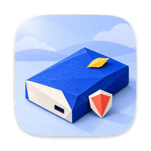

  

<h1 align="center">Yuzu NTFS</h1>

<b>Use Windows (NTFS) drives on your Mac — just plug in.</b> 
macOS 26+ · Apple silicon and Intel (experimental) · <b>Beta 0.1.2</b>

  

---

Your Mac can open a Windows-formatted drive but can't save anything to it. Yuzu NTFS adds opt-in NTFS writing to macOS, so a backed-up, clean drive can be used in Finder.

## Love it? Help it grow 🍋

> 🎁 **Yuzu NTFS is free.** Your support keeps it updated for new macOS versions and funds new Yuzu apps.

  
  

Or tell a friend who uses Windows drives on a Mac — one click shares it for you:

  
  
  

## What you can do

<table>
  <tr><td>🔌&nbsp;<b>Plug&nbsp;in&nbsp;and&nbsp;go</b></td><td>NTFS drives mount automatically in Finder. No Terminal, no extra steps.</td></tr>
  <tr><td>✏️&nbsp;<b>Read&nbsp;and&nbsp;write</b></td><td>Copy, save, rename and delete files on drives that come from Windows PCs.</td></tr>
  <tr><td>🛡️&nbsp;<b>Your&nbsp;data&nbsp;comes&nbsp;first</b></td><td>If Windows didn't shut down cleanly (Fast Startup, hibernation) or the drive needs checking, it opens <b>read-only</b> instead of risking your files. Nothing is changed behind your back.</td></tr>
  <tr><td>🔒&nbsp;<b>Keeps&nbsp;your&nbsp;Mac&nbsp;secure</b></td><td>No kernel extension, no Recovery Mode, no lowering security settings, no restart. Uninstall by dragging the app to the Trash.</td></tr>
  <tr><td>⚡&nbsp;<b>Fast</b></td><td>File data moves straight between the drive and macOS, so copies run close to the drive's own speed.</td></tr>
  <tr><td>🪟&nbsp;<b>Windows-friendly</b></td><td>Names, folders, links and Mac file info are stored in ways Windows understands. No <code>._</code> clutter files.</td></tr>
  <tr><td>🍋&nbsp;<b>Lives&nbsp;in&nbsp;the&nbsp;menu&nbsp;bar</b></td><td>See each NTFS drive, free space, RW/RO status and read-only reasons; open, eject or opt in to writing per drive.</td></tr>
</table>

## Download

  

Signed and notarized by Apple · **Apple silicon and Intel (experimental), macOS 26 or newer** · [all releases](https://github.com/bluecoral-vn/yuzu-ntfs/releases). Open the DMG and drag **Yuzu NTFS.app** into Applications before opening it. Intel support is experimental in this beta: compiled and structurally checked, but not yet tested on Intel hardware. Intel Macs support macOS up to version 26.

Yuzu NTFS checks for updates automatically through **yuzu.today**; use **Check for Updates…** in the menu to check manually, or change automatic checks in settings. Eject Yuzu NTFS and other FSKit drives before installation; a waiting update resumes after ejecting. **0.1.0 users must install 0.1.1 manually once** (eject drives, quit, replace the app in Applications). Subsequent updates use Sparkle.
 
### Developer dependency notice

The app target (never the FSKit extension) uses [Sparkle 2.10.0](https://github.com/sparkle-project/Sparkle/releases/tag/2.10.0), copyright Sparkle Project contributors, under the [MIT license](https://github.com/sparkle-project/Sparkle/blob/2.10.0/LICENSE). `scripts/release.sh` independently downloads checksum-pinned release tools, signs updates with the `yuzu-ntfs` login-Keychain account, notarizes and staples the DMG, and produces `build/direct/appcast.xml`. The public EdDSA key is `Xn34tDBWHQSFOu1+/uRuDEU9VSr3eLlCzgR6q8su8tc=`; private signing material must never be exported or committed.

## How to use

1. Open the app in Applications. Read and accept **“Beta — keep a backup of data you can't replace”** before enabling writes.
2. With all FSKit drives ejected, click **Enable Yuzu NTFS**. This enables only Yuzu's module, keeps a timestamped settings backup and refreshes your user’s FSKit agent. **Open System Settings** is also available; onboarding includes macOS 26 instructions.
3. Connect an NTFS drive. It starts **read-only**. Open the Yuzu NTFS menu to see its mode and reason.
4. For a backed-up drive, turn on **Allow writing (beta)**. Close open files first: Yuzu unmounts and remounts that volume without sudo. Turning it off remounts read-only. Hibernated, Fast Startup, dirty or unsupported drives **stay read-only regardless**; follow the Windows-side instructions shown.
5. Copy, rename and delete files in Finder. **Eject** before unplugging. To stop Yuzu entirely, eject all FSKit drives and choose **Disable Yuzu NTFS**. Quitting alone does not disable the extension.

> **Beta warning:** keep backups. Sparse files are read-only; compressed and encrypted file contents are not writable. After an engine error, new writes are blocked, but data in already-mapped, already-allocated ranges can still change until eject (**M-R1**). macOS 26, physical SSD and Windows `chkdsk` acceptance remain pending; do not use the beta on irreplaceable data.

**Good to know:** BitLocker-encrypted drives and formatting disks as NTFS are not supported. For a new shared Mac/Windows disk, exFAT is the simplest choice. The app has no telemetry; **Export diagnostics** creates a ZIP you review and send manually.

## Found a problem or have an idea?

[**Open an issue**](https://github.com/bluecoral-vn/yuzu-ntfs/issues/new) — tell us what happened, your macOS version and your drive. Lost or damaged files? Say so in the title; we look at those first.

## More from Yuzu Apps

Small, private Mac apps from [**yuzu.today**](https://yuzu.today) — no account, no tracking.

| | App | What it does |
|:-:|---|---|
|  | [**Yuzu Drag**](https://yuzu.today/drag/) | Convert, compress and share files just by dragging them. |
|  | [**Yuzu Clipboard**](https://yuzu.today/clipboard/) | Find anything you copied — text, links, images and files. |
|  | [**Yuzu Shot**](https://yuzu.today/shot/) | Capture, annotate and save screenshots. |
|  | [**Yuzu Awake**](https://yuzu.today/awake/) | Keep your Mac awake for as long as you need. |
|  | [**Yuzu MagicMenu**](https://yuzu.today/magic-menu/) | New File, Move To and Copy To in Finder's right-click menu. |
|  | [**Yuzu Sum**](https://yuzu.today/sum/) | A notepad calculator: answers appear as you type. *Coming soon.* |
|  | [**Yuzu Sync**](https://yuzu.today/sync/) | Keep folders in sync across your Mac, external disks and NAS. *Coming soon.* |

---

Free and open source under the [GNU GPL v2](LICENSE). Made by Blue Coral. Developers: see [docs/development.md](docs/development.md).
